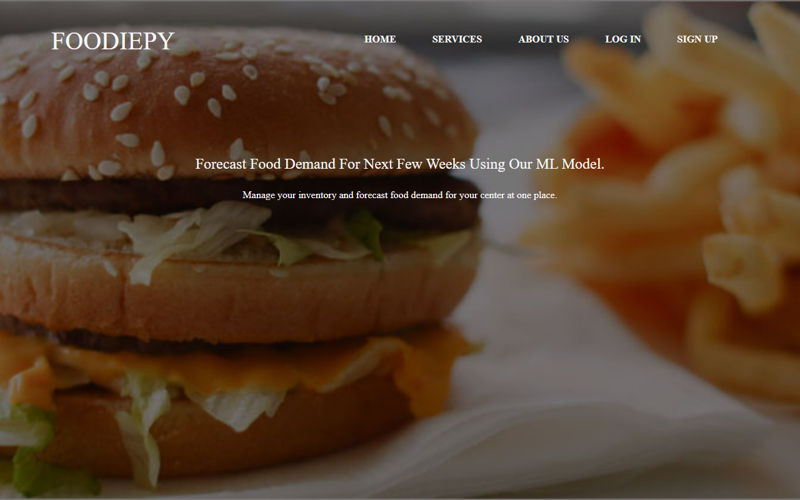
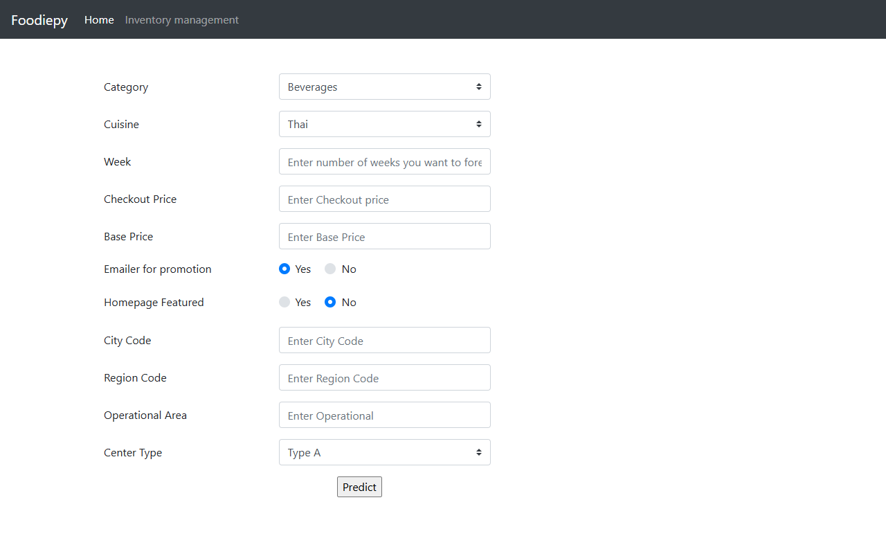

# Foodiepy

Food demand forecasting and inventory management for restaurants and fulfilment centres, built with Django.


[](https://github.com/smadhu6364-beep/foodiepy/actions/workflows/ci.yml)



## Why

A food delivery business works with perishable stock. Order too much and it goes to waste; order too little and customers go elsewhere. Foodiepy predicts how many orders a fulfilment centre should prepare for, and gives owners a simple place to track stock, customers and orders.

## Features

- **Demand forecast** - a Gradient Boosting regression model takes meal category, cuisine, prices, promotions and centre details, and returns the expected number of orders. In the original project it reached 92% train / 83% test accuracy.
- **Inventory dashboard** - sign up, log in, add products and customers, and track order status (pending, out for delivery, delivered).
- **Order filtering** with django-filter.



## Stack

| Layer | Tech |
|---|---|
| Backend | Python, Django 5.2 LTS, SQLite |
| ML | scikit-learn Gradient Boosting (trained in [this Colab notebook](https://colab.research.google.com/drive/1-IlwSyDkheIBuSZuY2EgYnS4EqRiZ9kQ?usp=sharing)) |
| Frontend | Django templates, Bootstrap 5, HTML/CSS |

## Quick start

```bash
git clone https://github.com/smadhu6364-beep/foodiepy.git
cd foodiepy
python -m venv .venv
.venv\Scripts\activate          # Windows
# source .venv/bin/activate     # macOS / Linux
pip install -r requirements.txt
cp .env.example .env            # set DJANGO_DEBUG=True for local use
python manage.py migrate
python manage.py createsuperuser
python manage.py runserver
```

Open http://127.0.0.1:8000. Run the tests with `python manage.py test`.

| Variable | Purpose |
|---|---|
| `DJANGO_SECRET_KEY` | Signing key. A dev placeholder is used if unset; set a real one before deploying. |
| `DJANGO_DEBUG` | `True` locally, `False` in production (default). |
| `DJANGO_ALLOWED_HOSTS` | Comma-separated hostnames, needed when debug is off. |

## Project structure

```
accounts/              app: models, views, forms, templates, tests
shop_management_app/   Django project settings and URLs
static/                CSS, fonts, images
.github/workflows/     CI (check, migrations, tests on Python 3.11 and 3.13)
```

## Status

- Upgraded in 2026 from Django 3.1 to Django 5.2 LTS. `manage.py check`, migrations and the test suite pass in CI.
- **The trained model file `gradientboostmodel.pkl` is not in this repository** (it was never committed). Without it the forecast page shows a clear message instead of crashing. To re-enable forecasting, retrain the model from the Colab notebook with the current scikit-learn and drop the `.pkl` in the project root.
- Built as a university group project; not tuned for any real company's data.

Demo video: https://youtu.be/45kdILuQyTs

## Contributors

- Darshan Bhavsar - https://www.linkedin.com/in/darshan-bhavsar-93370721a/
- Jigar Parmar - https://www.linkedin.com/in/jigar-parmar-b507a3229/
- Nirmal Trivedi - https://www.linkedin.com/in/nirmal-trivedi-80929a23b/
- Madhu

## License

MIT - see [LICENSE](LICENSE).
